<div align="center">


# Sharded Trolls

### **One token, eight ledgers on eight NEAR shards: a launch kit for coins that expect a claim rush**

<br>

[](./LICENSE)
[](https://testnet.nearblocks.io/address/play.strl.testnet)
[](#how-it-works)
[](#what-is-checked)
[](./Cargo.toml)
[](#development)
[](https://strl.xavio.dev)
[](#track-near-hackathon-2026--memecoins)

<br>

**[Reviewers](#for-reviewers-verify-in-ten-minutes)** · **[Track](#track-near-hackathon-2026--memecoins)** · **[Background](#the-background)** · **[What it does](#what-it-does)** · **[Try it](#try-it-do-x--see-y)** · **[Use it](#use-it)** · **[Tour](#tour)** · **[How it works](#how-it-works)** · **[Transfer flow](#cross-troll-transfer-flow)** · **[Results](#results)** · **[What is checked](#what-is-checked)** · **[Interface](#contract-interface)** · **[Invariants](#invariants)** · **[Deployments](#deployments)** · **[Limits](#limits-and-known-issues)** · **[Where it lives](#where-it-lives)** · **[Develop](#development)** · **[License](#license)**

<br><br><br>
</div>

**Sharded Trolls** is a launch kit for tokens that expect a claim rush. **STRL** is the first coin on it. A token on the kit is eight contracts, the **trolls**, one on each reachable NEAR shard. Every holder lives at one troll. Crossing from one troll to another pays the **Troll Toll**, and the troll you cross into eats it. A daily game, **the Feeding**, pays rewards when all eight trolls are fed, and burns part of a troll's hoard when it starves. The troll code is published once on chain, so the next token on the kit costs only its accounts.

Try it at **[strl.xavio.dev](https://strl.xavio.dev)**: the story, the [app](https://strl.xavio.dev/app), the [pitch deck](https://strl.xavio.dev/pitch), the [litepaper](https://strl.xavio.dev/paper) and the [evidence](https://strl.xavio.dev/evidence). Agents can read all of it at [`/llms.txt`](https://strl.xavio.dev/llms.txt).

<p align="center">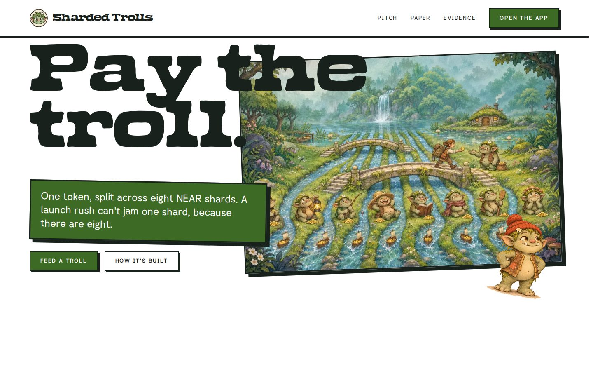</p>

> ### ⚠️ NEAR testnet · no mainnet deployment yet
> STRL runs on **NEAR testnet only**; testnet tokens have no value. The contracts went through five internal audit passes but have **not been independently audited**. Load numbers come from a **synthetic single-node local network** with mainnet's shard layout, not from mainnet. Transfers are **not faster** per transfer; the gain is throughput and no congestion rejections.

---

## For reviewers: verify in ten minutes

Every claim in this README maps to a file in [`measurements/`](./measurements), a testnet transaction, or a command you can run. Nothing below needs keys.

| Claim | Evidence | Check it yourself |
|---|---|---|
| 8 trolls on 8 distinct shards, one code | `k7` in [`k-tests.json`](./measurements/testnet-2026-11-14-final/k-tests.json): every troll's `global_contract_hash` is `8XXviK8P…FAEk` | `npm run check` (live layouts) · [0.v2.strl.testnet](https://testnet.nearblocks.io/address/0.v2.strl.testnet) … [u.v2.strl.testnet](https://testnet.nearblocks.io/address/u.v2.strl.testnet) |
| One transaction fans out to 50 transfers, 0 failed | `k2.fires` | [7vfVPpib…](https://testnet.nearblocks.io/txns/7vfVPpibkMEiaAuiH1QrmMPi9JrFLFso4BUqvcQDdVwG) (50 same-troll) · [FmxC1w4o…](https://testnet.nearblocks.io/txns/FmxC1w4oJ5sWK16YPRyL9DgABVVoUN87uxku9cfP3kTc) (25 mixed) |
| A failed credit refunds in full | `k3.cases[1]` | [7VRt7xdu…](https://testnet.nearblocks.io/txns/7VRt7xduJCaHzmPHBBpXBznbAsf9MKoCLGp6q8hJJ9vY) (receiver not registered, sender change 0) |
| A landed credit pays the toll as food | `k3.cases[0]` | [2qDR6KTG…](https://testnet.nearblocks.io/txns/2qDR6KTGaWBjAxLvtXY8tk1ypuZBRFtSMGRXNx4jqY19) |
| 4 KB message bound at 100 Tgas | `k3.cases[3–4]` | [8TX1vb82…](https://testnet.nearblocks.io/txns/8TX1vb82fL6tB3g9xJGepQiiTj4jfVgo4tHHzPDBpL63) (4,096 B works) · [52XF6YZb…](https://testnet.nearblocks.io/txns/52XF6YZbj1NzdruczhHEFBXrketsywoHD233DWjR6GGB) (4,097 B refused, nothing debited) |
| Settlement needs 250 Tgas and never locks | `settle.attempts` | [3MoXPip6…](https://testnet.nearblocks.io/txns/3MoXPip6HarBiVkPboPAj821ZPEWN8Y1yitt6t8PZVvQ) (249 Tgas refused) · [7Emqj2qN…](https://testnet.nearblocks.io/txns/7Emqj2qNSkobSGgQauF5TEXz8cWBTZPYGbUdHW9vn3y7) (250 Tgas settled, bounty paid) |
| A starving troll burns 1% of its hoard | `S1` in [`feeding.json`](./measurements/testnet-2026-11-14-final/feeding.json) | [AdY2c4Yu…](https://testnet.nearblocks.io/txns/AdY2c4Yusb1yK1UqADtgEZrK6GXysviBcgBWYNh5ws2K) (625,000 STRL burned) |
| A second token costs ~3.65 NEAR on the same code | [`kit-deploy.json`](./measurements/testnet-2026-11-14-final/kit-deploy.json), [`kit-k7.json`](./measurements/testnet-2026-11-14-final/kit-k7.json) | [kit.strl.testnet](https://testnet.nearblocks.io/address/kit.strl.testnet) |
| Same-troll ≈ 6× and mixed ≈ 1.9–2.4× one token's capacity, 0 congestion rejections (synthetic) | [`localnet-2026-11-14/summary.json`](./measurements/localnet-2026-11-14) and 9 per-block runs | `npm run localnet`, `npm run deploy:local`, `npm run load` (needs near-sandbox) |
| Supply is conserved after every step | 125 contract unit and property tests; `conservation` in every testnet record | `cargo test -p troll -p root` |
| Every deployment path survives injected faults | [`rehearsal-final-summary.json`](./measurements/localnet-2026-11-14): 30/30 twice | `scripts/rehearse-localnet.sh` |

**Fastest path:** `cargo test -p troll -p root -p troll-types -p wrapper` (no network), `npm run test:js && npm run check` (one RPC read), then open any transaction above. The [Evidence](https://strl.xavio.dev/evidence) page shows the same records rendered, and [`/evidence.md`](https://strl.xavio.dev/evidence.md) lists every JSON file.

**What we do not claim:** faster transfers, mainnet numbers, an independent audit, or Sybil resistance. See [Limits](#limits-and-known-issues).

---

## Track: NEAR HACKATHON 2026 · Memecoins

| Track | What Sharded Trolls builds on |
|---|---|
| **Memecoins** | NEAR **global contracts** (one troll code by hash for all eight trolls and every future token), NEP-141, NEP-145, NEP-148, NEP-297 and NEP-330 |

The meme is the mechanic: eight trolls, a toll at every bridge, and a daily Feeding that needs all eight. Underneath it is a sharded fungible-token ledger that is deployable today.

### Where NEAR is used

| NEAR feature | Used for | In Sharded Trolls |
|---|---|---|
| **Global contracts** (deploy by code hash) | All 8 trolls run one published code, `8XXviK8PceCwicgzFtKi2VoBNWR7MXFMBkZSDKNuFAEk`; a new token publishes no code | [`scripts/deploy.mjs`](./scripts/deploy.mjs) (`--global-hash`) |
| **Shard layout** (protocol 88, 10 shards) | Each troll account name is chosen so it lands on a distinct shard | [`packages/layout/`](./packages/layout) (`shardOf`, `place`) · `npm run check` |
| **Asynchronous receipts** | The three-step cross-troll transfer with refund on failed credit | [`contracts/troll/src/lib.rs`](./contracts/troll/src/lib.rs) (`ft_transfer`, `credit`, `on_credit`) |
| **Joined promises** | The root gathers all eight troll reports before deciding fed or starved | [`contracts/root/src/lib.rs`](./contracts/root/src/lib.rs) (`settle`, `on_reports`) |
| **NEP-141 / NEP-145 / NEP-148** | Each troll is a self-describing token with storage registration and metadata | [`contracts/troll/src/lib.rs`](./contracts/troll/src/lib.rs) |
| **NEP-297 events** | Each troll logs its own side of a transfer (ERC-7802's burn-at-source, mint-at-destination), so every troll's log balances on its own | [`contracts/troll/src/lib.rs`](./contracts/troll/src/lib.rs) |
| **NEP-330** | Source metadata on the published code, from a cargo-near reproducible build | [`contracts/troll/Cargo.toml`](./contracts/troll/Cargo.toml) |

### Prior art

Sharded fungible tokens on NEAR are not new. NEP-636 "Sharded Fungible Token" is a draft, opened 2026-01-29 and blocked on Universal Implicit Account Ids as of 2026-10-06, with a reference implementation in near-sdk-rs#1376. Sharded Trolls takes a different approach: a fixed set of eight ledgers, one per shard, deployable today.

As of 2026-11-14 18:20 UTC, a scan of all 1,674 projects in the NEAR HACKATHON 2026 field (posts, READMEs and linked sites) found no other fungible-token ledger split across shards or contracts. The nearest prior art there is the House of Stake "Sharded NFT Items" draft (one account per NFT).

### Other project by the same author

**Yuki**: a long-term investment thesis for NEAR backed by on-chain data (Investment Thesis track). Repository: [github.com/xavio2495/Yuki](https://github.com/xavio2495/Yuki) · Live site: [yuki.xavio.dev](https://yuki.xavio.dev/). The two projects are independent: they share no project code (only stock Next.js configuration and a font licence file).

---

## The Background

A NEAR contract lives on one shard, so a token is normally one shard's worth of capacity:

- **NEAR never splits a contract.** Shards split only at account boundaries, so one contract always lives on one shard. Mainnet runs 10 shards (protocol 88), and dynamic resharding is off. A token that wants room on more than one shard has to be more than one contract.
- **What filled NEAR's shards was claim-heavy consumer apps.** Before the 2024-03-21 split at `game.hot.tg`, the shard holding it averaged 42.5% chunk fullness against 10.2% on the other shards; its top receivers were earn.kaiching, game.hot.tg, wallet.kaiching and relay.tg. Before the 2025-03-19 split at `earn.kaiching`, the parent shard averaged 12.3% against 7.5%, and three KaiChing accounts took 66% of sampled receipts. Launch claims and daily claims are that kind of load. [`measurements/mainnet/split-causes-2026-11-13.jsonl`](./measurements/mainnet)
- **The sharded-token draft does not spread yet.** NEP-636 uses one wallet contract per holder, at NEP-616 ids that start with `0s`. Under today's mainnet layout all of those ids sort below the first shard boundary (`650`), so they would sit on one shard until a future split.
- **Headroom, not a rescue.** Mainnet is not congested today: over one hour on 2026-11-12 the shards averaged 0.04–2.5% of chunk gas, with single-chunk peaks up to 84% (shard 8). [`measurements/mainnet/shard-load-2026-11-12.json`](./measurements/mainnet)

**Sharded Trolls splits the token instead.**

1. **Eight ledgers, eight shards.** Each troll account sits on a distinct shard, checked against the live mainnet and testnet layouts.
2. **Hash homes.** A holder's home troll is a hash of the account id, so the crowd spreads evenly whatever the account names look like.
3. **One code.** The troll code is a global contract, so all eight provably run the same code and the next token reuses it.

---

## What it does

- **Spreads holder-to-holder traffic** (claims, tips, transfers) over eight shards. A same-troll transfer is one receipt and touches no other shard.
- **Crosses shards safely:** debit, credit, confirm. A failed credit refunds in full; a landed credit is never refunded, so a failure can never mint.
- **Feeds the trolls:** the 0.25% Troll Toll on a cross-troll transfer becomes the destination troll's food, and pays its feeders.
- **Runs the Feeding:** each day every troll needs enough distinct senders. All fed: the streak grows and feeders are paid. A troll that misses starves and burns 1% of its hoard.
- **Settles without an operator:** anyone can close the day and earn a small NEAR bounty paid from claim fees; a stuck settlement restarts on its own.
- **Ships as a kit:** a new token deploys a root and eight troll accounts by code hash for about 3.65 testnet NEAR.
- **Trades through a wrapper:** a standard single-shard NEP-141 backed 1:1 by troll tokens, for DEXes (built, not deployed).

It is not:
- **Faster per transfer.** A same-troll transfer takes 1 block, a cross-troll one 2. On mainnet, being on the same shard saves nothing: a follow-up receipt ran 1 block later on the same shard (14 of 14 samples) and across shards (64 of 65; one took 2). [`measurements/mainnet/receipt-latency-2026-11-13.json`](./measurements/mainnet)
- **A fix for a hot app.** If every holder calls one game or pool, that is one account on one shard.
- **Sharded trading.** DEXes use the wrapper, which is one contract on one shard.

---

## Use it

### Try it: do X → see Y

No install needed. You need a NEAR **testnet** account in a browser wallet (Meteor, HOT or any other NEAR Connect wallet); testnet NEAR is free from the [faucet](https://docs.near.org/getting-started/faucet).

| # | Do | See |
|---|---|---|
| 1 | Open [strl.xavio.dev](https://strl.xavio.dev) and scroll | The problem (42.5% / 66%), one river wiping into eight streams, debit → credit → confirm, the proof numbers |
| 2 | Open [strl.xavio.dev/app](https://strl.xavio.dev/app) | One screen: the round timer (10-minute rounds), the eight trolls with their feeders (`0/1`), *Close the round*, *Live activity* |
| 3 | Tap **Connect wallet** and pick a testnet wallet | The big button becomes **Get 1,000 STRL**; your home troll is named |
| 4 | Tap **Get 1,000 STRL** and approve (0.01 NEAR fee + storage) | Your balance shows 1,000 STRL; *Live activity* shows the claim |
| 5 | Tap **Feed 1 STRL** and approve | 1 STRL goes to the tip jar `tips.play.strl.testnet`; your home troll's tile lights up and its count reads `1/1` |
| 6 | Tap **Details** in the trolls strip | Per troll: shard, feeders, food, hoard, launch pool, supply |
| 7 | Type an account in **Send to a friend**, any amount, tap **Send** | The note says whether it stays on your troll (free) or crosses to another (0.25% toll, eaten by that troll as food) |
| 8 | After the round ends, tap **Close the round** (anyone can) | The round settles: all trolls fed → the streak grows; any troll starved → it burns 1% of its hoard. A bounty is paid if the budget holds one |
| 9 | Then tap **Collect** | Your share of the round's reward is added to your balance |
| 10 | Open any transaction from *Live activity* or the [reviewer table](#for-reviewers-verify-in-ten-minutes) | The receipts on [testnet.nearblocks.io](https://testnet.nearblocks.io): debit on one shard, credit on another |

Without a wallet: steps 1, 2 and 6 work as they are, the [deck](https://strl.xavio.dev/pitch) and [evidence](https://strl.xavio.dev/evidence) need nothing, and [`/app.md`](https://strl.xavio.dev/app.md) lists every call for scripts or agents.

### In the browser

[**strl.xavio.dev/app**](https://strl.xavio.dev/app): connect a testnet wallet (Meteor or any NEAR Connect wallet), get 1,000 STRL in one tap, feed a troll, collect your share. It runs on the play deployment `play.strl.testnet` with **short testnet parameters**: 10-minute rounds and 1 feeder per troll (launch values: 24-hour rounds and 10 feeders). Starter-bag claims stay open until 2026-11-28.

### As contract calls

Every app action is a plain contract call; [`/app.md`](https://strl.xavio.dev/app.md) lists them with gas and deposits.

| Step | Call | On |
|---|---|---|
| Find your home troll | view `home_troll` {"account_id"} | root |
| Claim a starter bag (once) | `claim_launch` {}, 30 Tgas, claim fee + storage deposit if unregistered | your home troll |
| Feed (once a round) | `ft_transfer` {"receiver_id", "amount"} ≥ 1 STRL, 50 Tgas, 1 yocto | your home troll |
| Collect | `claim` {"epoch"}, 30 Tgas | your home troll |
| Close the round | `settle` {"epoch"}, ≥ 250 Tgas | root |

```js
// home troll = first 16 bytes of sha256(account_id), big-endian, mod 8
import { homeIndex } from "./packages/client/index.js";
const i = await homeIndex("alice.testnet", 8);   // index into the root's `trolls` view
```

### Launch your own token on the kit

```sh
node --dns-result-order=ipv4first scripts/deploy.mjs --network testnet --parent <your-parent> \
  --key-file <parent-key.json> --global-hash <troll code hash> --symbol <SYM> --name "<Name>" --troll-near 0.2
```

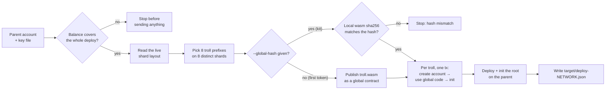

It publishes no code: a root plus eight troll accounts, placed on eight distinct shards. Between transactions it waits for earlier gas refunds to land, and a partial deploy can resume. Measured on testnet: about 3.65 NEAR per token (8 × 0.2 NEAR for the trolls plus gas, and 1.89 NEAR locked for the root's storage). The script checks the balance first and stops before sending anything if it is short.

### For agents

| URL | Content |
|---|---|
| [`/llms.txt`](https://strl.xavio.dev/llms.txt) | Index of every page, with the facts to keep straight |
| [`/llms-full.txt`](https://strl.xavio.dev/llms-full.txt) | Every page in one file |
| `/index.md` · `/pitch.md` · `/paper.md` · `/evidence.md` · `/app.md` | Each page as markdown; the deck's figures are described in words |

---

## Tour

| | |
|---|---|
| 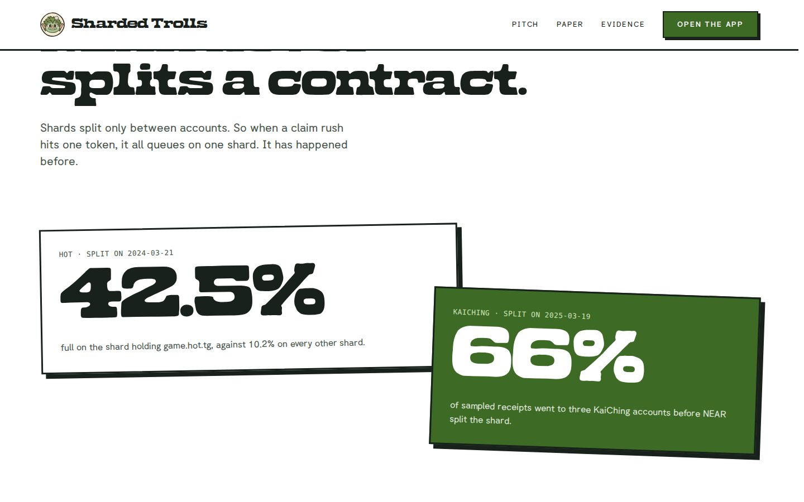 | 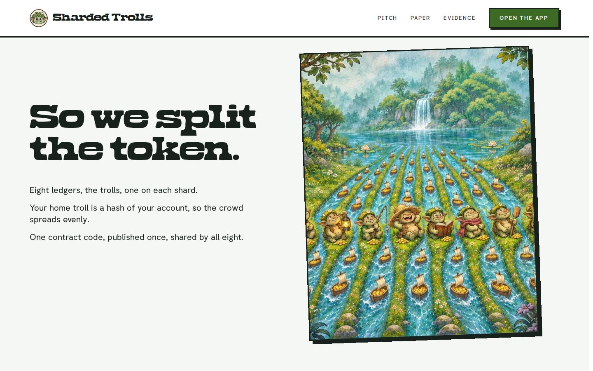 |
| **The problem.** Claim rushes filled NEAR's shards before (HOT 42.5%, KaiChing 66%). | **The fix.** One river becomes eight streams as you scroll: eight ledgers, one per shard. |
| 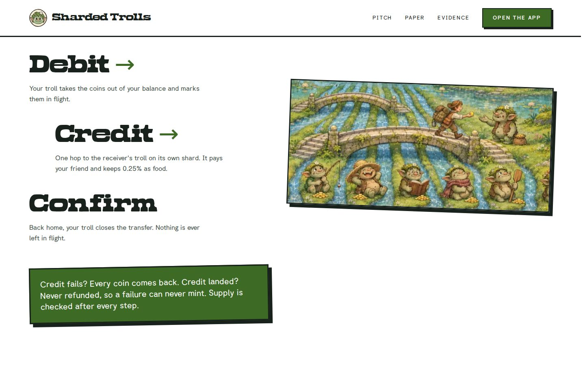 | 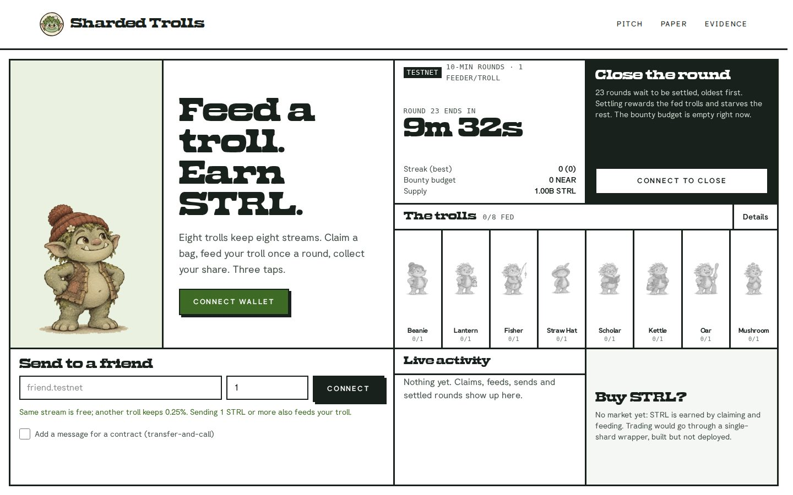 |
| **Crossing a shard.** Debit, credit, confirm; a failure refunds, a landed credit never does. | **The app.** One screen: claim, feed, collect, close the round. Live testnet state. |
| 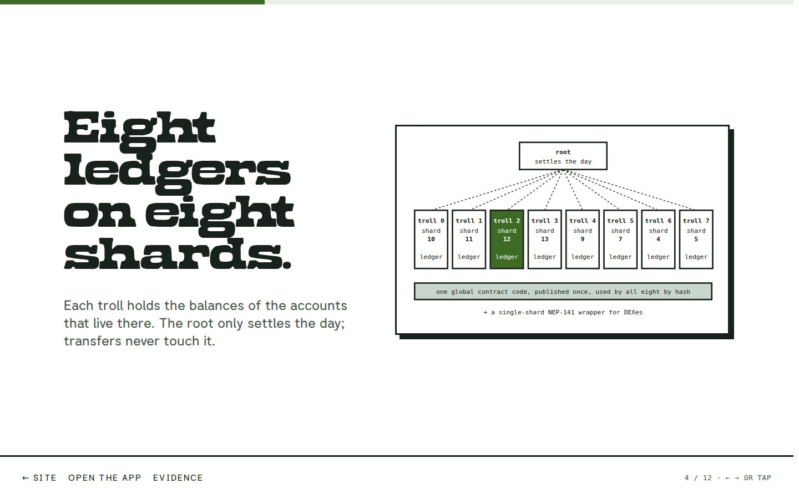 | 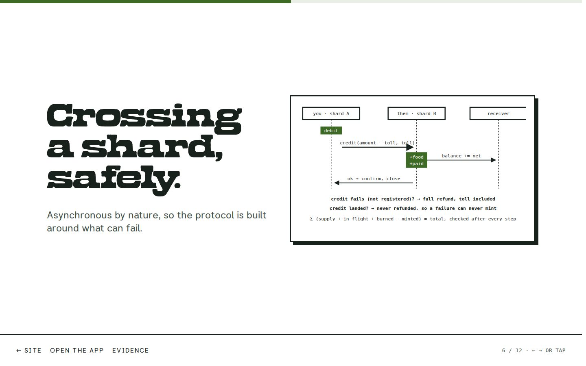 |
| **Deck: architecture.** The root settles; transfers never touch it. | **Deck: the transfer.** Three receipts, with the refund and never-mint rules. |
| 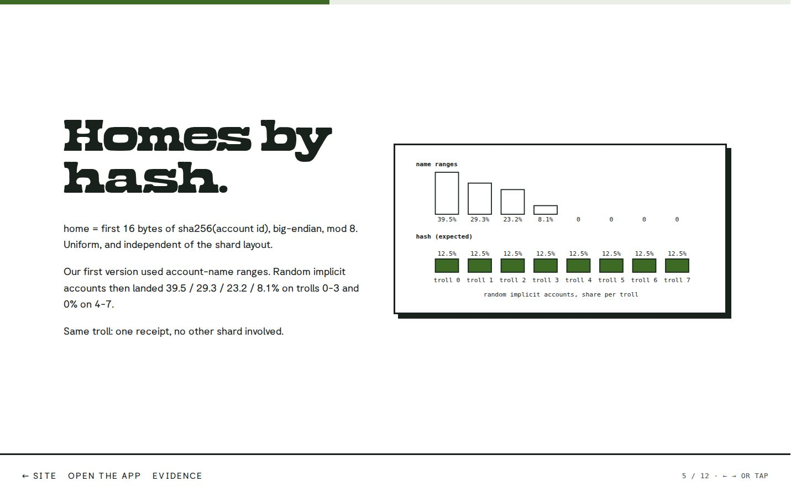 | 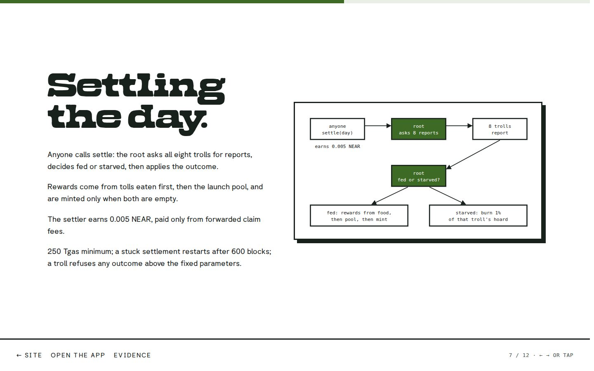 |
| **Deck: homes by hash.** Name ranges piled onto half the trolls; the hash spreads 12.5% each. | **Deck: settling.** Anyone settles; fed trolls pay, a starving troll burns. |
| 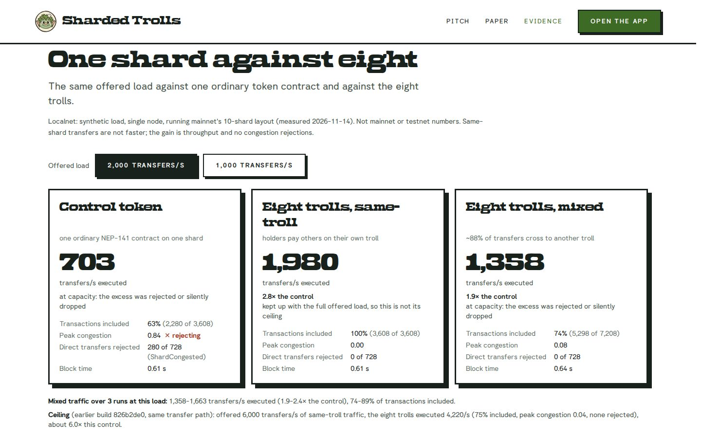 | 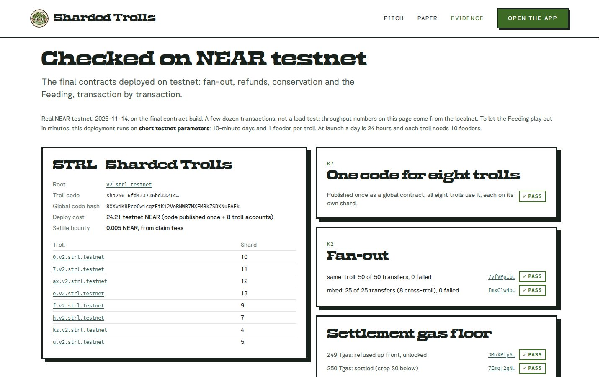 |
| **Evidence: compare.** Same offered load, one token vs eight trolls (synthetic localnet). | **Evidence: testnet.** Each check with its transaction. |

---

## How it works

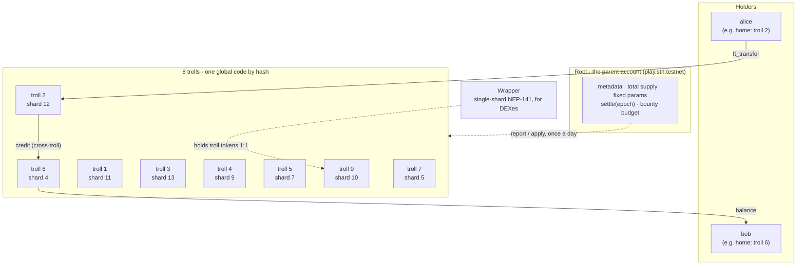

| Piece | Role |
|---|---|
| Root (the parent account) | Metadata, total supply, immutable parameters, daily settlement. Never touched by transfers |
| 8 trolls (`<prefix>.<parent>`) | Balances of their holders, per-day sender counts, hoard, launch pool. One global contract code |
| Wrapper | Standard NEP-141 backed 1:1 by troll tokens it holds; single-shard, for DEXes |

- **Home troll:** the first 16 bytes of sha256(account_id), big-endian, mod 8. Uniform and independent of the shard layout. Clients compute it ([`packages/client`](./packages/client)) or ask the root's `home_troll` view. With hash homes, about 7 in 8 transfers between random holders cross trolls.
- **Registration:** a standard NEP-145 storage deposit at your home troll. Holders pay their own storage. Unregistering first pays any claimable rewards into your balance; it is refused while that balance is not zero, unless forced (which burns it).
- **Launch claim:** each account can claim a 1,000-token starter bag at its home troll during the launch window, for a 0.01 NEAR fee. The troll keeps the part that pays for the claim's own storage record (~0.0006–0.0011 NEAR) and forwards the rest to the root's bounty budget. Only that budget pays settle bounties; no other NEAR on the root is ever paid out.
- **The Troll Toll:** 0.25% of every cross-troll transfer is paid to the troll you cross into. It becomes that troll's food and funds its feeders' rewards, so nothing is burned by tolls. The toll is a design choice, not cost recovery: senders already pay the extra receipt's gas in NEAR.
- **The Feeding:** each day every troll counts its distinct senders (sends of at least 1 token).
  - If all eight trolls reach the target, the streak grows. Each troll pays its feeders a reward, **first from its food, then from its unclaimed launch pool**, and only then by minting.
  - A troll that misses the target starves: it burns 1% of its hoard, and the streak resets.
- **Settling:** anyone can call `settle({"epoch": N})` on the root for the next finished day, attaching at least 250 Tgas (300 recommended). A settlement that never finishes can be restarted after 600 blocks. The root pays whoever settles a 0.005 NEAR bounty if the budget holds enough; the bounty can never block settlement.
- **Claims and sweeps:** feeders call `claim({"epoch": N})` at their home troll within 30 days of that day's settlement, or are paid automatically on their next counted send. After the deadline anyone can `sweep` the day, and a troll also sweeps on its own as it settles: unclaimed shares go back to its food, and old per-day records are deleted, so a troll's storage stays bounded.
- **Bounded by its parameters:** a troll refuses any reward or burn the root asks for above the fixed parameters, so the root can't over-mint or over-burn.
- **No admin:** parameters are fixed at init and no method changes them. At the mainnet launch every full-access key on the root, trolls and wrapper is to be deleted (not done yet: there is no mainnet deployment, and the testnet root keeps its key).
- **Consistency:** a balance lives at exactly one troll and is always exact. The root's `ft_total_supply` is as of the last daily settlement; each troll's `ft_total_supply` is live for that troll.

### Finding your troll

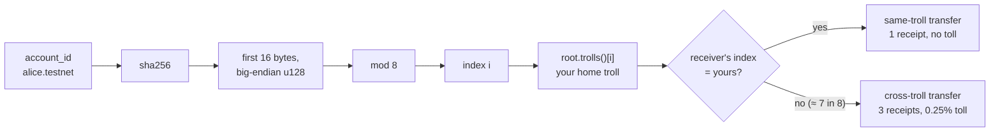

The contract checks it too: `claim_launch` refuses an account that is not at its home troll, and a credit to an account not registered at its home troll fails and refunds.

### Where tokens live and move

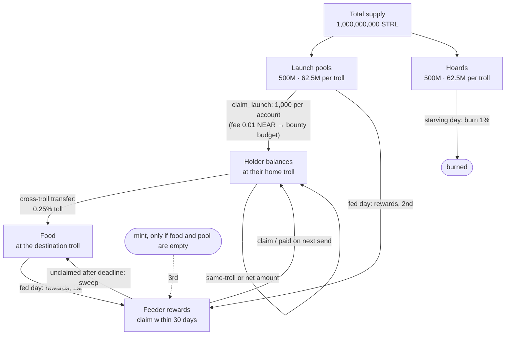

### A round, from open to swept

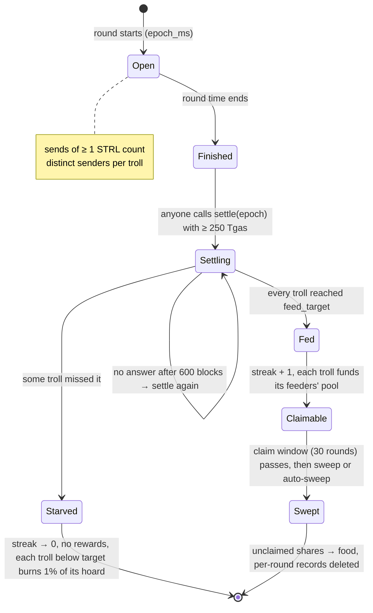

### Settling a round

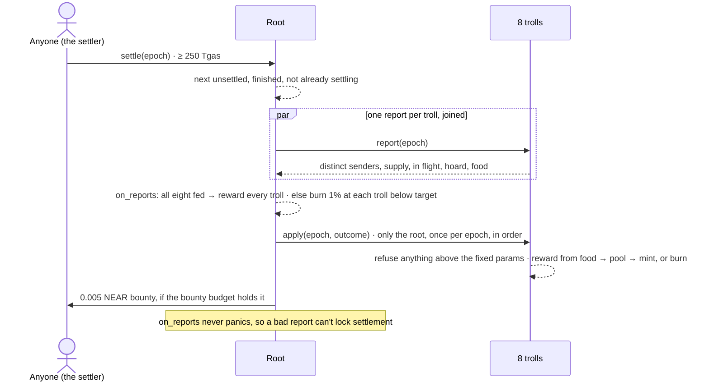

### Parameters

| Parameter | Value |
|---|---|
| Total supply | 1,000,000,000 STRL, 24 decimals |
| Launch pool | 500,000,000 (62.5M per troll) |
| Hoards | 500,000,000 (62.5M per troll) |
| Launch claim | 1,000 per account; fee 0.01 NEAR; window 24 h |
| Day (epoch) | 24 h |
| `feed_target` | 10 distinct senders per troll per day |
| `min_counted_transfer` | 1 token |
| Reward | 250,000 per fed day across the trolls: from food first, then the launch pool, then minted |
| Starve burn | 1% (100 bps) of the starving troll's hoard |
| Troll Toll | 0.25% (25 bps) of each cross-troll transfer, paid to the destination troll as food |
| Settle bounty | 0.005 NEAR to whoever settles a day, from the bounty budget (forwarded claim fees) |
| Claim window | 30 days after a day's settlement; then the share returns to the troll's food |

Launch simulation with these parameters (`node sim/d24.js`): with 4,000 holders about 4M tokens are claimed, and the rest of the pool pays the reward for about 1,984 days, so the Feeding mints nothing in that time. (`npm run sim` runs the earlier 60-day model, whose defaults predate the claim fee and pool-funded rewards.)

---

## Cross-troll transfer flow

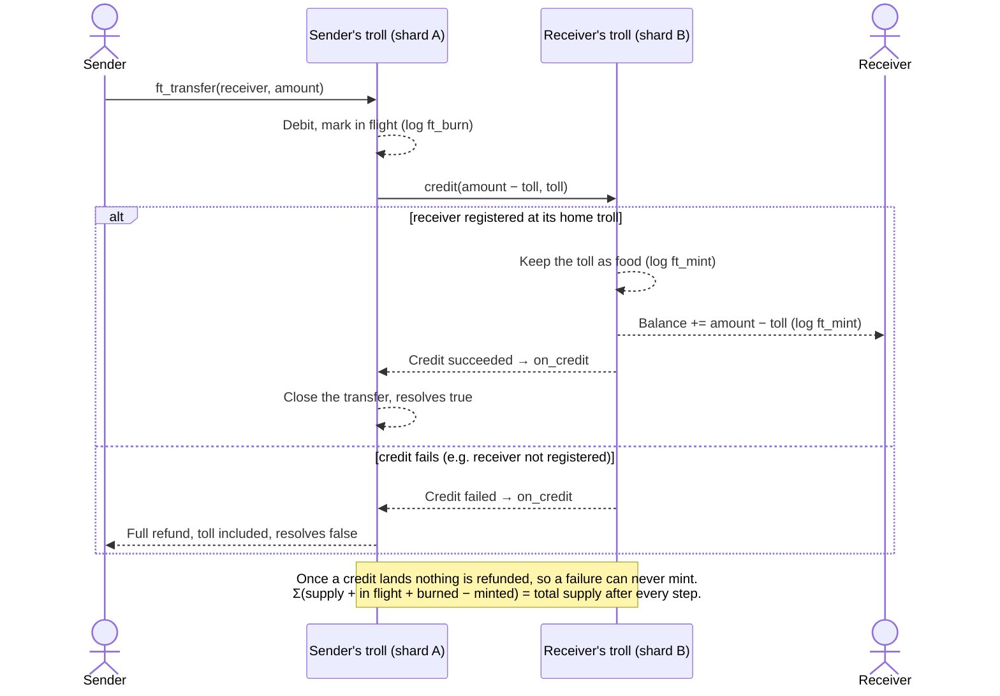

`ft_transfer_call` works within and across trolls; attach at least 100 Tgas. Across trolls, the receiver's troll credits and calls `ft_on_transfer`, and the unused part comes back to the sender. Messages over 4 KB are rejected before any debit.

---

## Results

### On NEAR testnet (2026-11-14)

The final contracts, deployed under `v2.strl.testnet` (token STRL), on **short testnet parameters** so the Feeding plays out in minutes: 1 feeder per troll and 10-minute days. A few dozen real transactions, not a load test. Every check passed. Records: [`measurements/testnet-2026-11-14-final/`](./measurements/testnet-2026-11-14-final), shown transaction by transaction on the [Evidence](https://strl.xavio.dev/evidence) page.

| Check | Result |
|---|---|
| One code for eight trolls | All 8 trolls run global contract `8XXviK8PceCwicgzFtKi2VoBNWR7MXFMBkZSDKNuFAEk`, the sha256 of `troll.wasm`, on shards 10, 11, 12, 13, 9, 7, 4 and 5. Deploy cost: 24.21 testnet NEAR |
| Fan-out | One stampede transaction → 50 of 50 same-troll transfers; another → 25 of 25 mixed transfers (8 cross-troll); 0 failed receipts |
| Cross-troll transfer | Sender −100; the receiver's troll keeps the 0.25 toll as food |
| Credit to an unregistered receiver | The credit fails and the sender is fully refunded (change 0) |
| Cross-troll `ft_transfer_call` to an account with no contract | The unused amount is returned; the sender pays only the toll |
| `ft_transfer_call` at exactly 100 Tgas | A 4,096-byte message works; 4,097 bytes is refused before anything is debited |
| Settlement gas floor | `settle` at 249 Tgas is refused up front and leaves settlement unlocked; at 250 Tgas it settles |
| The Feeding, day 0 | 8 feeders, one per troll, each crossing a stream; every troll eats a 0.25 STRL toll. Settled: fed, streak 1, rewards from food first, then the launch pool; the settler earned the 0.005 NEAR bounty |
| The Feeding, day 1 | Seven trolls fed, one not. That troll starved and burned 625,000 STRL (1% of its hoard); streak back to 0 |
| A second token on the same code | `kit.strl.testnet` (KIT) deployed by code hash, no code published: about 3.65 NEAR |
| Conservation | Σ over the trolls of (supply + in flight + burned − minted) = total supply, and the root agrees with all eight trolls, after every step |

Earlier runs on earlier builds (`st.xavio.testnet`, `st2.xavio.testnet`) are kept in [`measurements/`](./measurements).

### Under synthetic load (local network)

A single-node localnet (near-sandbox 2.14.1, protocol 88) running mainnet's 10-shard layout, 1,000 Tgas chunks and mainnet's congestion thresholds. **Not mainnet or testnet:** one node runs all ten shards, so absolute numbers are a lower bound and the comparison is the point. The control is one ordinary NEP-141 contract. Every transaction was looked up afterwards, and receivers' balances matched what the included transactions should deliver, to the yocto. [`measurements/localnet-2026-11-14/summary.json`](./measurements/localnet-2026-11-14)

| Offered load | Control token | Trolls, same-troll | Trolls, mixed (87.5% cross) |
|---|---|---|---|
| 2,000/s for 90 s | 703/s executed; 63% included; congestion 0.85; 280 of 728 direct transfers rejected (`ShardCongested`) | **1,980/s** (all of it); 100% included; congestion 0; 0 rejected | **1,358–1,663/s** over three runs on three successive builds (1,358/s on the current one); 73–89% included; congestion ≤ 0.08; 0 rejected |
| 1,000/s for 60 s | 672/s; a backlog built (congestion 0.30) and drained after the load stopped | — | **969/s** (all of it); 100% included; congestion 0 |

- **Ceiling:** offered 6,000/s of same-troll traffic (earlier build, same transfer path), the trolls executed 4,220/s, 75% included, congestion 0.04, none rejected.
- **In round numbers:** same-troll traffic gets about 6× the control's capacity, mixed traffic about 1.9–2.4×. No transaction to a troll was rejected for congestion; the control's were.
- **Silent drops** (this single-node localnet, control and trolls alike): past about 70–85% chunk fullness the node sometimes accepted a transaction and never included it, with congestion far below 0.8. A multi-node network has not been checked.

---

## What is checked

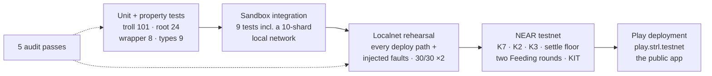

| Layer | How |
|---|---|
| **Audits** | Five passes on 2026-11-14: a manual review, then the `near-contract-audit` checklist on the base contracts, on the toll-as-food and bounty changes, and on each hardening fix and its amendment. Every Critical and High finding fixed; every Medium fixed except one inherent to async transfers and disclosed below |
| **Unit and property tests** | troll 101, root 24: conservation runs of 3 × 10,000 steps and 30-day lifecycles with random transfers, transfer-and-calls, failed and refunded credits, restarted settlements, claims, expiry and sweeps. After every step: supply, an indexer-style replay of each troll's events, and root = trolls |
| **Sandbox integration** | Including a local network with mainnet's 10-shard layout and the full Feeding lifecycle: claim fees → tolls → settle with bounty → claims → starve → stuck settlement restarted |
| **Deployment rehearsals** | Every deployment path scripted on that local network with fault injection: rate limits mid-deploy and resume, underfunded deploys, code-hash mismatch, settlement timeout, reward expiry and sweep. Two final passes on the hardened build: 30 of 30 checks each ([`rehearsal-final-summary.json`](./measurements/localnet-2026-11-14)) |
| **Testnet** | The eleven checks above, transaction by transaction |
| **Layout** | `npm run check`: the 8 trolls sit on 8 distinct shards under today's live mainnet and testnet layouts |

---

## Contract interface

### Troll (`<prefix>.<parent>`, one global code)

| Method | Kind | Who may call | Notes |
|---|---|---|---|
| `ft_transfer(receiver_id, amount, memo?)` | change, 1 yocto | holder, at their home troll | routes to the receiver's home troll; cross-troll resolves `true`/`false` |
| `ft_transfer_call(receiver_id, amount, memo?, msg)` | change, 1 yocto | holder | ≥ 100 Tgas, `msg` ≤ 4,096 bytes |
| `claim_launch()` | change, payable | any account, once, at its home troll, inside the launch window | fee + storage deposit if unregistered |
| `claim(epoch)` | change | a feeder of that round | within the claim window |
| `sweep(epoch)` | change | anyone, after the deadline | unclaimed shares → food |
| `credit` · `credit_call` | change | **only sibling trolls** | the cross-troll leg |
| `on_credit` · `on_credit_call` · `resolve_credit_call` · `ft_resolve_transfer` | callback | the troll itself | confirm, refund, or return unused |
| `report(epoch)` · `apply(epoch, …)` | change | **only the root** | apply at most once per round, in order, bounded by params |
| `storage_deposit` · `storage_withdraw` · `storage_unregister` · `storage_balance_of` · `storage_balance_bounds` | NEP-145 | anyone / holder | register at the **home** troll |
| `ft_balance_of` · `ft_total_supply` · `ft_metadata` | view | anyone | `ft_total_supply` is live for this troll |
| `info` · `params` · `trolls` · `home_troll` · `is_feeder` · `has_claimed_launch` · `senders_in` · `pool` · `current_epoch` | view | anyone | `info`: senders, supply, in flight, hoard, pool, food, minted, burned |

### Root (the parent account)

| Method | Kind | Who may call | Notes |
|---|---|---|---|
| `settle(epoch)` | change | anyone | ≥ 250 Tgas; the next unsettled finished round; restarts after 600 blocks |
| `fund_bounty()` | change, payable | anyone (trolls forward claim fees) | the only NEAR the root ever pays out |
| `on_reports(epoch, attempt)` | callback | the root itself | never panics; ignores a stale attempt |
| `info` · `params` · `trolls` · `home_troll` · `streak` · `current_epoch` · `ft_metadata` · `ft_total_supply` | view | anyone | `ft_total_supply` as of the last settlement |

### Wrapper (single shard, for DEXes; built, not deployed)

| Method | Notes |
|---|---|
| `ft_on_transfer` | called by its home troll after a troll-token `ft_transfer_call`: mints 1:1 to the registered sender, or returns everything |
| `unwrap(amount)` | burns wrapped tokens and pays troll tokens to the caller's home troll (a cross-troll payout pays the toll); re-mints if the payout fails |
| standard NEP-141 / NEP-145 | `ft_transfer`, `ft_transfer_call`, `ft_balance_of`, `storage_*`, … |

---

## Invariants

These hold after every step in the property tests and in every testnet record:

1. **Conservation.** Σ over the trolls of (supply + in flight + burned − minted) = total supply.
2. **Root agrees.** After each settlement the root's per-troll supply equals each troll's own.
3. **No negative balance.** A debit needs the full balance; nothing goes below zero.
4. **Never mint on failure.** A failed credit refunds the sender in full; a landed credit is never refunded.
5. **Bounded settlement.** A troll applies each round at most once, in order, and never more reward or burn than the fixed parameters allow; it never pays more food than it holds.
6. **One home.** A balance lives at exactly one troll, chosen by the hash; claims and registrations are checked against it.
7. **No admin.** No method changes parameters after init; access is limited to root → troll (`report`, `apply`) and troll → sibling (`credit`).

---

## Limits and known issues

### Sybil limits, plainly

- **Keeping the streak alive with bots is cheap:** about 0.02 NEAR a day plus 0.16 NEAR of setup for 80 bots.
- **Bots can take most of the daily reward once the token has value.** The reward is split equally among feeders: at a fully diluted value of 10,000 NEAR a farmer takes about 65% of it; at 100,000 NEAR, about 89%; below about 1,000 NEAR farming does not pay. Food from tolls funds the same equal split. A stake-weighted split would close this hole; it is not built.
- **Draining the launch pool does not pay** below about 10,500 NEAR of value. Taking the whole pool would need 500,000 claims (about 5,250 NEAR).
- Sub-accounts count as separate accounts. **The Feeding is a game, not a Sybil-proof mechanism.**

### Known issues

- **Integrators, registration:** register receivers at their **home** troll (the root's `home_troll` view, or `packages/client`, which does it before sending). A wallet that registers receivers on the sender's troll fails for about 7 in 8 receivers.
- **Integrators, results:** a cross-troll `ft_transfer` can succeed as a transaction yet deliver nothing. It resolves to `true` when the receiver was credited and `false` when the transfer was refunded. Contracts that send tokens must check that value. (The disclosed Medium.)
- **Fixed before launch:** a cross-troll `ft_transfer_call` with a very large `msg` (hundreds of KB) could run out of gas after the debit and lose the transfer. Messages over 4 KB are now rejected before any debit, and the credit step has more gas reserved (tested at exactly 100 Tgas).
- **Out-of-order delivery (not seen in practice):** if a troll ever received a day's report before the previous day's payout, that payout could draw less food and mint a little more than the root booked. A troll never pays more food than it holds, and the root's total corrects itself at the next settlement.
- **Root NEAR:** only NEAR sent through `fund_bounty` can be paid out as bounties. Any other NEAR on the root stays there for good: there is no withdraw method.
- A malicious same-troll receiver can return an oversized result from `ft_on_transfer`, leaving the sender's pending counter stuck so the sender can't unregister; no tokens are lost.
- **Wallets and explorers** see one token per troll touched, some with balance 0. Explorers attribute a troll's hoard, pools and food to the troll's own account, but `ft_balance_of(troll)` returns 0.

### Next

Optimistic credit (two receipts instead of three, researched, not built), a stake-weighted reward split, the wrapper on a DEX, and mainnet.

---

## Deployments

All on NEAR **testnet**. There is no mainnet deployment.

| Deployment | Root | Trolls | Purpose |
|---|---|---|---|
| **Play** (the public app) | [`play.strl.testnet`](https://testnet.nearblocks.io/address/play.strl.testnet) | 8 under `play.strl.testnet`; read the root's `trolls` view | the app at strl.xavio.dev; 10-minute rounds, 1 feeder per troll; tip jar `tips.play.strl.testnet`; claims open until 2026-11-28 |
| **Final checks** | [`v2.strl.testnet`](https://testnet.nearblocks.io/address/v2.strl.testnet) | `0` · `7` · `ax` · `e` · `f` · `h` · `kz` · `u` `.v2.strl.testnet` on shards 10, 11, 12, 13, 9, 7, 4, 5 | every check in [Results](#results) |
| **Kit** (second token) | [`kit.strl.testnet`](https://testnet.nearblocks.io/address/kit.strl.testnet) | 8, same global code | proves the kit: no code published, ~3.65 NEAR |
| Earlier builds | `st.xavio.testnet` · `st2.xavio.testnet` · `feed.strl.testnet` | | kept in [`measurements/`](./measurements) |

| Code | Hash |
|---|---|
| Troll (global contract, base58) | `8XXviK8PceCwicgzFtKi2VoBNWR7MXFMBkZSDKNuFAEk` |
| Troll `troll.wasm` sha256 (hex) | `6fd433736bd3321cc23fd592bf224df7c1f9459451b74ec60bacea62f39ff871` |
| Root wasm sha256 (hex) | `ec05d61f1945f83cb1fb86549dbd021933123fc6ab44687ce663814819aa8bda` |

---

## Where it lives

### Contracts

| Capability | Code |
|---|---|
| **Troll ledger:** NEP-141/145/148, home check, claims, sweeps | [`contracts/troll/src/lib.rs`](./contracts/troll/src/lib.rs) (`ft_transfer`, `claim_launch`, `claim`, `sweep`, `storage_*`) |
| **Cross-troll transfer:** debit, credit, confirm, refund | [`contracts/troll/src/lib.rs`](./contracts/troll/src/lib.rs) (`credit`, `on_credit`, `credit_call`, `on_credit_call`) |
| **The Feeding, troll side:** reports and bounded apply | [`contracts/troll/src/lib.rs`](./contracts/troll/src/lib.rs) (`report`, `apply`) |
| **Root:** settlement, bounty, home lookup | [`contracts/root/src/lib.rs`](./contracts/root/src/lib.rs) (`settle`, `on_reports`, `fund_bounty`, `home_troll`) |
| **Shared params and types** | [`contracts/types/`](./contracts/types) |
| **DEX wrapper** (single-shard NEP-141, 1:1) | [`contracts/wrapper/`](./contracts/wrapper) |
| **Stampede** (one transaction fans out to many transfers) and the **control** token | [`contracts/stampede/`](./contracts/stampede) · [`contracts/control/`](./contracts/control) |

### Tooling and site

| Capability | Code |
|---|---|
| **Shard placement** and live layout check | [`packages/layout/`](./packages/layout) (`shardOf`, `place`, `check.js`) |
| **Client:** home troll, routing, registration before sending | [`packages/client/`](./packages/client) (`homeIndex`) |
| **Deploy by code hash**, with balance and hash checks | [`scripts/deploy.mjs`](./scripts/deploy.mjs) |
| **Testnet checks** (K2, K3, K7, the Feeding) | [`scripts/testnet-k.mjs`](./scripts/testnet-k.mjs) |
| **Local network, load and measurement** | [`scripts/localnet.mjs`](./scripts/localnet.mjs) · [`scripts/load.mjs`](./scripts/load.mjs) · [`scripts/measure.mjs`](./scripts/measure.mjs) |
| **Deployment rehearsals with fault injection** | [`scripts/rehearse-localnet.sh`](./scripts/rehearse-localnet.sh) · [`scripts/lib/`](./scripts/lib) |
| **Supply and Sybil simulations** | [`sim/`](./sim) |
| **Website**, app and agent-readable pages | [`web/`](./web) (Next.js) · [`web/app/lib/agent/`](./web/app/lib/agent) |

---

## Repository layout

```
contracts/     troll, root, wrapper, types, stampede (load generator), control (one ordinary NEP-141)
integration/   sandbox tests, including a local network with mainnet's 10-shard layout
packages/      layout (shard placement, live check) and client (home troll, routing)
scripts/       deploy, testnet checks, localnet, load, measurement, rehearsals, faucet helpers
sim/           supply and Sybil simulations
measurements/  every number in this README, as JSON: mainnet probes, localnet runs, testnet checks
web/           the website, app, deck, litepaper and evidence (Next.js, deployed on Vercel)
web-html/      the static evidence pages kept from the first site
docs/          screenshots used in this README
```

---

## Development

**Prerequisites:** Rust stable with `wasm32-unknown-unknown` (pinned in `rust-toolchain.toml`), `cargo-near`, and Node 24. The JS tools have no dependencies.

```sh
# Contracts: unit tests, conservation property runs, event replay
cargo test -p troll -p root -p troll-types -p wrapper

# Sandbox integration, including a 10-shard local network
cargo test -p integration

# JS tools: layout, client, scripts and simulation tests
npm run test:js
npm run check     # 8 trolls on 8 distinct shards, against the live mainnet and testnet layouts
npm run sim       # supply simulation -> sim/out/ (CSV + SVG)

# Website
cd web && npm install && npm run dev    # http://localhost:3000
```

All code was written during the NEAR HACKATHON 2026 build window (2026-11-12 to 2026-11-14). Libraries: near-sdk, near-contract-standards, near-api, near-sandbox and cargo-near. Built with AI assistance (Claude Code).

---

## License

MIT ([`LICENSE`](./LICENSE)), xavio2495.

> **Testnet software:** provided "as is", without warranty of any kind. Sharded Trolls has not been independently audited.

---

<br><br>

<div align="center">

<h3>Built By

[Immanuel](https://github.com/xavio2495)

</h3>
</div>
